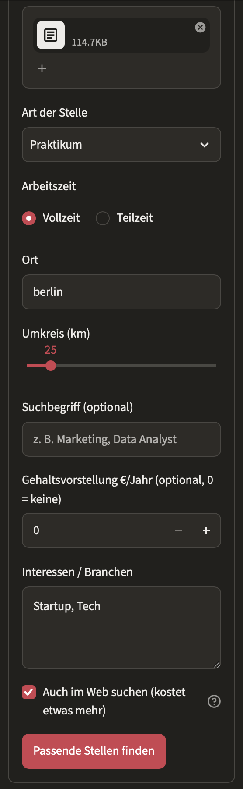
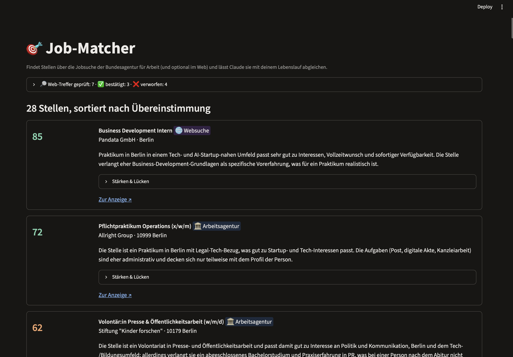
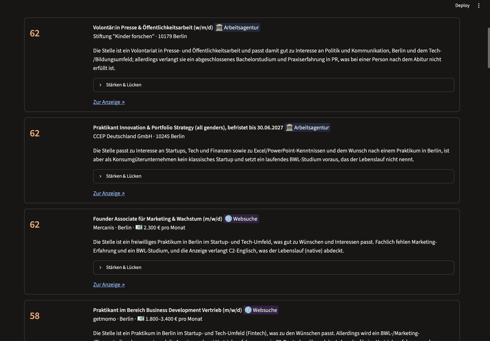

# Job-Matcher

A local web app that matches a CV against current job postings in Germany. You upload your CV
as a PDF, the app collects postings from the job search API of the German Federal Employment
Agency (Bundesagentur für Arbeit) and, optionally, from company career pages. Claude
then scores each posting from 1 to 100 and explains the score.

I built it for my own internship search. Going through dozens of listings by hand and judging
how well each one fits takes a lot of time. This tool does that first pass for me, so I only
read the postings that actually fit.

The user interface is in German.





## Features

- CV upload (PDF with real text, not a scan)
- Filters: job type (internship, working student, full-time, apprenticeship), full-/part-time,
  location and radius, optional keyword, salary expectation, interests
- Score from 1 to 100 for each posting, with a short explanation, strengths and gaps
- Optional web search on company career pages and applicant tracking systems
  (Personio, Greenhouse, Ashby, Lever, Join)
- Every web result is checked: the app opens it to confirm that it is a single, still-open posting
- Duplicate postings from both sources are merged
- Token usage and estimated cost are shown after every run

## How it works

1. **Read the CV:** the text is extracted from the PDF with `pypdf`.
2. **Search:** the Federal Employment Agency API returns up to 25 postings, with their full descriptions.
3. **Web search (optional):** Claude runs up to 5 web searches and returns up to 10 postings as structured JSON.
4. **Verify web results:** a posting is kept only if its link appeared in the actual search results.
   Claude then opens each link with the web fetch tool. Deleted postings, listing pages and pages
   without readable text are dropped. For postings that remain, the full text of the page replaces
   the short summary.
5. **Merge duplicates:** postings with the same company and a similar title are merged into one.
6. **Score:** Claude Haiku scores each posting against the CV and the user's preferences.
   Requests run in parallel and return structured output (Pydantic schema).
7. **Display:** results are sorted by score, and a summary of usage and cost is shown at the end.

## Design decisions

**Permitted data sources only, no scraping.** Postings come from the Federal Employment Agency's
job search API and from Claude's web search tool. The API is publicly accessible and used by the
agency's own job portal, but it is not officially documented; the documentation used here comes from
the community project [bundesAPI](https://github.com/bundesAPI/jobsuche-api). LinkedIn, Indeed, StepStone and
Glassdoor are blocked in the search and fetch tools (`WEB_GESPERRTE_DOMAINS` in `config.py`).
Their terms of service do not allow automated access.

**Protection against invented postings.** Language models can produce plausible-looking links
that do not exist. A web result is only kept if its URL (normalised: host, path, no tracking
parameters) appears in the raw search results that the API returned. Claude's answer alone is
not enough.

**Checking that postings are still open.** Search indexes are often out of date. Every web result
is opened with web fetch. A posting counts as confirmed only if the exact posting URL was fetched
successfully in this run. If a link leads to a listing page, Claude looks for the specific posting
there and opens it. The app reports how many results were checked, confirmed and dropped, with
the reason for each one dropped.

**Cost control.**
- The cheapest model (Claude Haiku 5.5) with low effort is used for every call.
- The CV and the instructions are identical for every posting, so they are sent as a cached system
  prompt (prompt caching). Only the posting itself is new input for each request.
- Limits on web searches per run, page fetches per posting, tokens per fetched page and description
  length, all set in `config.py`.
- Web search is off by default.
- Usage (searches, fetches, input/output/cached tokens) and an estimated cost are shown after every run.

**Security.**
- The API key is read from a `.env` file, which is listed in `.gitignore`. Only `.env.example`
  with a placeholder is in the repository.
- Streamlit is bound to `localhost` (`.streamlit/config.toml`), so the app, and with it the uploaded
  CV, cannot be reached from the local network.
- The CV is not stored by the app. It is held in memory and sent only to the Claude API.

## Setup

Requirements: Python 3.10+ and an Anthropic API key ([platform.claude.com](https://platform.claude.com)).

```bash
git clone https://github.com/leonhard-frey/bewerbungs-copilot.git
cd bewerbungs-copilot
python3 -m venv .venv
source .venv/bin/activate
pip install -r requirements.txt
cp .env.example .env    # then replace the placeholder with your API key
```

## Run

```bash
source .venv/bin/activate
streamlit run app.py
```

The app opens at http://localhost:8501.

## Cost per run

Estimates at list price (November 2026):

| Run | Approx. cost |
|---|---|
| 25 postings, Federal Employment Agency only | $0.01–0.02 |
| With web search (up to 5 searches, 10 web postings, including verification) | $0.05–0.08 |

Web search costs $0.01 per search plus tokens. Web fetch has no extra fee; only the tokens of the
fetched pages are billed. Prices and limits can be changed in `config.py`. The exact amount is
shown in the Claude Console (platform.claude.com).

## Project structure

| File | Purpose |
|---|---|
| `app.py` | Streamlit UI: form, progress, results, usage |
| `config.py` | Settings: model, limits, blocked domains, prices |
| `models.py` | Data models (search parameters, posting, score) |
| `cv_reader.py` | PDF text extraction |
| `matcher.py` | Scoring with Claude (structured output, caching, parallel requests) |
| `sources/` | Job sources behind a shared interface (`JobQuelle`) |
| `sources/arbeitsagentur.py` | Federal Employment Agency API |
| `sources/claude_websuche.py` | Claude web search plus link check |
| `sources/web_pruefung.py` | Verification of web results with web fetch |
| `zusammenfuehren.py` | Duplicate merging |
| `kosten.py` | Usage and cost tracking |

To add another source, create a class that inherits from `JobQuelle`, returns a list of `Stelle`
objects, and register it in `sources/__init__.py`.

## Limitations

- Scores are an LLM's estimate. They help to sort postings but do not replace reading them.
- Web fetch caches pages, so a posting that was deleted very recently may still appear open.
- Pages that load their content only with JavaScript return no text and are dropped.
- Scanned PDFs (images without a text layer) are not supported.
- The Federal Employment Agency API covers Germany only. Many startup postings are only found through web search.
- Cost figures are estimates based on list prices.
- No automated tests yet. Dependencies are not pinned to specific versions.
- Code identifiers and the UI are in German.

## Possible next steps

- Tests for duplicate merging, URL normalisation and the verification logic (with recorded API responses)
- Pinned dependency versions
- Saving results and tracking applications already sent
- More job APIs as sources
- An English UI

## Built with Claude Code

This project was built with [Claude Code](https://claude.com/claude-code). I defined the
features, data sources and safeguards and tested the app; the code was written by Claude Code.
